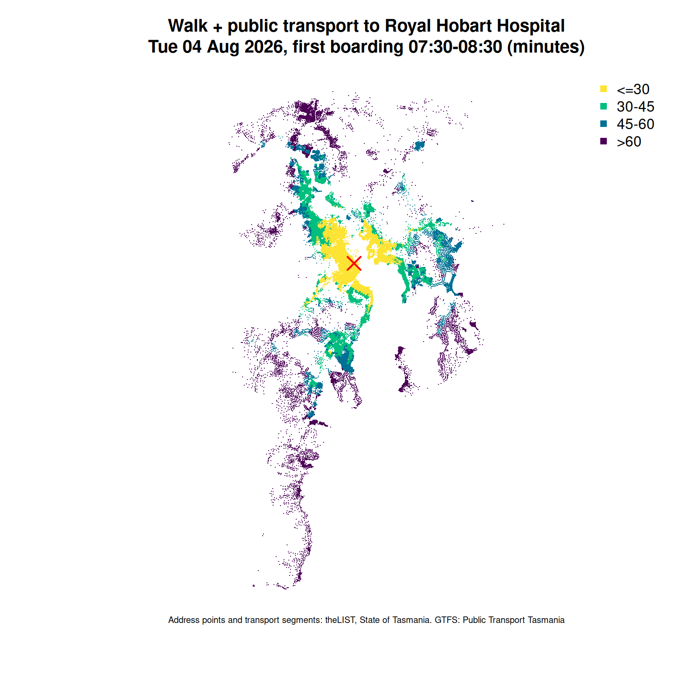
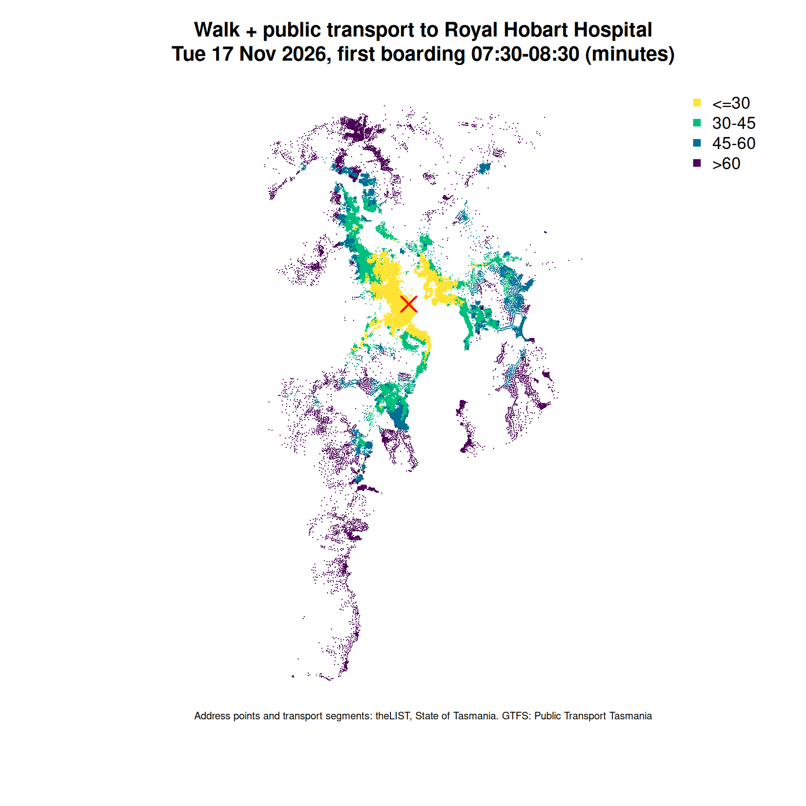
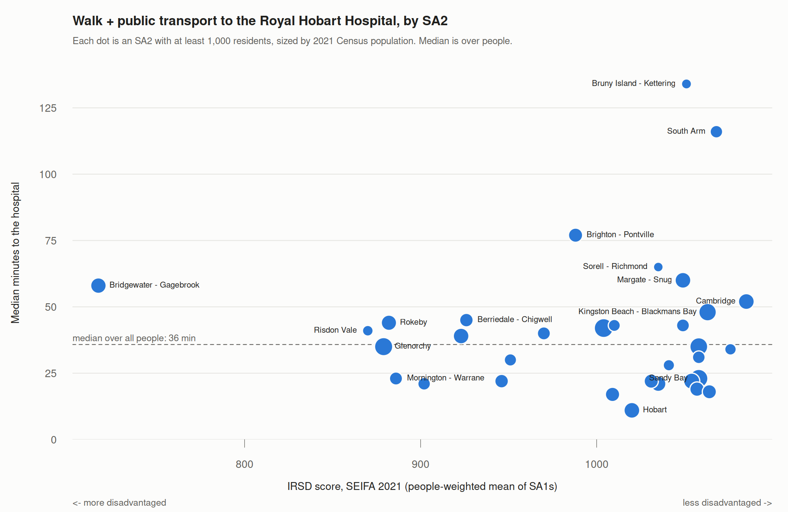

First end-to-end run of Hobart data through the UrbanAnalyst routing
packages, with a log of every point of friction. Scripts:
[scripts/02-hobart/](https://github.com/mdsumner/city.infra/tree/main/scripts/02-hobart).

## The question

How long does it take to get from home to the Royal Hobart Hospital
(48 Liverpool St) on a weekday morning, on foot or by walking plus public
transport? It is a simple access question with obvious social weight:
people who need the hospital most are often the people without a car.

## What was built

1. **Walk graph from LIST, not OSM.** 53,478 LIST transport segments in
   Hobart, Glenorchy, Clarence, Kingborough and Brighton, from the
   `tas-transport-web` layer on source.coop. Each segment carries LIST
   node ids (`node0`, `node1`), so the dodgr graph is built directly from
   the segment table with no geometry snapping: 102,108 directed edges and
   44,271 vertices in the largest connected component.
2. **Origins from LIST address points.** 109,357 addresses within 250 m of
   the walk graph (from the statewide address points in the thelist-opendata
   mirror). Addresses stand in for population until ABS data is wired in.
3. **Public transport.** A stop-to-stop travel time matrix for the 1,914
   stops in the study area (gtfsrouter, first boarding 07:30 to 08:30 on
   Tuesday 2026-08-04, trips up to 2 hours).
4. **Joining walk and transit.** For each boarding stop, the best time to the
   hospital door (ride to any stop, then walk). A virtual source joined to
   every boarding stop by an edge of that length turns the whole
   address-to-hospital problem into one dodgr shortest path run.

The whole run takes about 30 seconds on 4 cores.

## Results

These are the first-run figures. They are slightly affected by a bug found
later (friction point 8); corrected August figures and a comparison with
November are in the next section.

Map: the corrected August run (see below); the first-run map is kept at
[02-hobart/rhh-access-map.png](02-hobart/rhh-access-map.png). Each dot is
an address; the main panel covers the urban area from Brighton to Margate,
and the overview shows the whole study area down to the Huon Valley.

Share of addresses that can reach the hospital within a given time
(percent), and the median time in minutes:

| LGA | Addresses | Walk only, 30 min | Walk + PT, 30 min | 45 min | 60 min | Median (min) |
|---|---:|---:|---:|---:|---:|---:|
| Hobart | 27,844 | 37.7 | 90.8 | 99.5 | 99.9 | 18 |
| Glenorchy | 24,379 | 0 | 26.5 | 83.0 | 97.2 | 36 |
| Clarence | 30,514 | 0 | 36.6 | 69.0 | 89.8 | 38 |
| Kingborough | 17,566 | 0 | 1.4 | 46.6 | 78.0 | 46 |
| Brighton | 9,004 | 0 | 0 | 12.1 | 46.7 | 61 |
| All five | 109,357 | 9.6 | 39.5 | 71.6 | 88.5 | 36 |

(A handful of addresses fall in Derwent Valley and Huon Valley where they
snap to the edge of the network; they are in the CSV but left out here.)

Brighton stands out: fewer than half of its addresses reach the hospital in
an hour, with Bridgewater at a median of 61 minutes and Brighton itself 74.
Bridgewater and Gagebrook are the most disadvantaged SA2 in the study
area on SEIFA 2021 (see "People and disadvantage" below). Per-locality medians are in
[02-hobart/rhh-access-by-locality.csv](02-hobart/rhh-access-by-locality.csv).

### What the numbers assume

- Walking at 4.8 km/h on every LIST segment except rail and ferry, both
  directions, with no penalty for steep, busy or footpath-less roads.
- The rider times their departure perfectly: the time counts from the first
  boarding, with no wait at the stop. Real times are longer, most of all
  where service is infrequent, so the outer suburbs are flattered.
- One weekday in the August 2026 timetable, one morning window, one
  destination.

## Rerun: official statewide feed, November 2026

Same script and LIST inputs, on the official Public Transport Tasmania feed
(version 25, archived as `tas-statewide/2026-11-08`, see
[gtfs-feed-plan.md](gtfs-feed-plan.md)) for **Tuesday 2026-11-17**, the
first Tuesday after the feed's start date with no service exceptions. The
script now picks that date itself (or takes `GTFS_DATE`), writes `run.json`
with the feed hash and date, and a per-stop table of the best time from each
boarding stop to the hospital door. Outputs:
[02-hobart/2026-11-17-v25/](02-hobart/2026-11-17-v25/).

| LGA | Aug, first run | Aug, corrected | Nov | Aug corrected, 60 min | Nov, 45 min | Nov, 60 min |
|---|---:|---:|---:|---:|---:|---:|
| Hobart | 18 | 18 | 18 | 99.9 | 99.5 | 99.9 |
| Glenorchy | 36 | 36 | 35 | 97.4 | 84.0 | 97.4 |
| Clarence | 38 | 37 | 37 | 90.0 | 70.7 | 90.0 |
| Kingborough | 46 | 45 | 46 | 78.5 | 47.0 | 78.6 |
| Brighton | 61 | 60 | 60 | 48.1 | 13.5 | 48.1 |
| All five | 36 | 35 | 35 | 88.9 | 72.5 | 88.9 |

Medians in minutes; the last three columns are percent of addresses.
"First run" is the August result above, before the parallel-edge fix
(friction point 8). "Corrected" reruns the same feed (version 20, now
backfilled as `tas-statewide/2026-06-20`) and the same day, Tuesday
2026-08-04, with the fix: [02-hobart/2026-08-04-v20/](02-hobart/2026-08-04-v20/).

Two findings:

- **The timetable change from August to November barely moves access.**
  With the fix applied to both runs, only 6 of the 70 suburbs with at least
  200 addresses change their median, each by 1 or 2 minutes (Claremont 41 to
  39, Berriedale, Chigwell, Howden and Kingston 1 minute, Huntingfield 34 to
  35). Brighton is still the outlier, with under half of addresses within an
  hour.
- **The bug mattered more than the timetable.** The fix changes 21 of the
  70 suburbs in the August run, mostly by a minute; the largest are Howden
  (85 to 79) and Cambridge (41 to 38). The August figures in the Results
  section above are the first-run numbers and are kept as published; use the
  corrected ones.

## People and disadvantage (November feed)

The address results weighted by 2021 Census population and joined to SEIFA
2021 ([scripts/02-hobart/05_people_seifa.R](https://github.com/mdsumner/city.infra/tree/main/scripts/02-hobart/05_people_seifa.R)).
Each address is placed in its 2021 mesh block, and the mesh block's usual
resident population is shared equally among the study addresses in it. Each
address takes its SA1's Index of Relative Socio-economic Disadvantage (IRSD)
decile, ranked within Tasmania (1 = most disadvantaged). Outputs, including
per-SA2 and LGA by quintile tables, are in
[02-hobart/2026-11-17-v25/](02-hobart/2026-11-17-v25/).

Coverage: 226,352 people allocated to
109,357 addresses (69 addresses fall
outside any mesh block). Of Greater Hobart's
231,295 residents,
223,002
(96%) live in mesh
blocks that hold study addresses. 1,173 people are in
SA1s without an IRSD score.

**By disadvantage** (percent of people):

| IRSD quintile (Tasmania) | People | Within 30 min | 45 min | 60 min | Median (min) |
|---|---:|---:|---:|---:|---:|
| 1 most disadvantaged | 30,537 | 22.6 | 69.6 | 92.8 | 39 |
| 2 | 26,675 | 36.2 | 74.7 | 88.0 | 36 |
| 3 | 32,093 | 42.9 | 81.5 | 91.4 | 34 |
| 4 | 47,514 | 43.6 | 70.4 | 85.3 | 34 |
| 5 least disadvantaged | 88,360 | 42.2 | 66.6 | 86.2 | 35 |

**By LGA, people rather than addresses:**

| LGA | People | Within 30 min | 45 min | 60 min | Median (min) |
|---|---:|---:|---:|---:|---:|
| Hobart | 54,742 | 90.3 | 99.4 | 99.9 | 19 |
| Glenorchy | 50,483 | 29.7 | 83.3 | 97.2 | 36 |
| Clarence | 62,041 | 38.5 | 71.2 | 89.9 | 36 |
| Kingborough | 39,129 | 1.2 | 44.2 | 77.8 | 46 |
| Brighton | 19,332 | 0 | 14.3 | 46.9 | 61 |
| All | 226,352 | 39.2 | 71.0 | 87.9 | 36 |

Weighting by people barely changes the LGA picture against the address
counts above.

**SA2s in the three most disadvantaged deciles** (SA2s with at least 1,000
residents; decile is the people-weighted median of their SA1s):

| SA2 | IRSD decile (Tas) | People | Within 45 min | 60 min | Median (min) |
|---|---:|---:|---:|---:|---:|
| Bridgewater - Gagebrook | 1 | 8,184 | 2.2 | 61.9 | 58 |
| Berriedale - Chigwell | 3 | 5,706 | 50.7 | 83.0 | 45 |
| Rokeby | 2 | 7,895 | 71.2 | 99.4 | 44 |
| Risdon Vale | 2 | 2,902 | 93.2 | 97.1 | 41 |
| Claremont (Tas.) | 3 | 8,380 | 73.6 | 98.4 | 39 |
| Glenorchy | 2 | 12,257 | 93.5 | 100.0 | 35 |
| Mornington - Warrane | 2 | 5,162 | 100.0 | 100.0 | 23 |

What this shows:

- **Disadvantage is not simply distance.** The most disadvantaged fifth of
  people have a median of 39 minutes against 34 to 36 for
  the rest, and fewer of them are within 30 minutes (22.6%
  against 36 to 44%). But 92.8% are within an hour, the highest
  of any quintile: most live in middle-ring suburbs that this analysis finds
  reasonably well connected (Glenorchy, Rokeby, Risdon Vale, Mornington).
  The very long trips are mostly in outer areas that SEIFA ranks as less
  disadvantaged (South Arm, Kettering, Kingston Beach, Cambridge). Car
  ownership, which would sharpen this, is not in the analysis yet.
- **Bridgewater - Gagebrook is the clear outlier:** the most disadvantaged
  SA2 in the study area by a wide margin (decile 1),
  with a median of 58 minutes and only 61.9% of
  its 8,184 residents within an hour. It is where poor public
  transport and disadvantage coincide, and the strongest case in this
  analysis for service attention.

Caveats: 2021 Census and SEIFA against a 2026 timetable; population shared
equally across addresses in a mesh block (business and vacant addresses
take a share); IRSD describes areas, not individuals; and the times still
assume no wait at the first stop, which flatters the outer suburbs where
service is sparse.

## Friction log

Ordered by how much each one matters for UA work beyond Hobart.

1. **m4ra's multi-modal pipeline only takes OSM.** `m4ra_prepare_data()` and
   `m4ra_times_multi_mode()` expect an `osmdata_sc` network and build their
   own cache keyed by city name. There is no entry point for an
   authoritative network such as LIST, so this run used m4ra only for its
   GTFS stop matrix and did the network side with dodgr directly. A
   "bring your own graph" entry point is the single most useful change for
   cities with good government network data.
2. **m4ra silently caps transit trips at 60 minutes.**
   `m4ra_gtfs_traveltimes()` fixes `max_traveltime` at one hour, so longer
   trips simply disappear and those addresses fall back to walking. Same
   window, same day: with the cap the median for Brighton (the suburb) is
   120 minutes instead of 74, Pontville 135 instead of 89, and Kettering
   130 instead of 84. The outer suburbs, which matter most for equity, are
   exactly where the cap bites, and LGA-level medians hide it (Brighton LGA
   is 61 either way). Switching to `gtfsrouter::gtfs_traveltimes()` with a
   2 hour cap fixed it and was still quick (18 s for 1,914 stops, against
   6 s for m4ra). `USE_M4RA=1` reproduces the capped run.
3. **dodgr's weighting is keyed to OSM highway tags.** `weight_streetnet()`
   needs an OSM `highway` column; LIST's `TRAN_CLASS` (Access Road, Local
   Road, Collector, Arterial, Walking, Bike, Shared Use, and so on) needs a
   custom profile. This run used unweighted distances. A LIST weighting
   profile is a small, self-contained contribution.
4. **No walkability attributes in LIST.** LIST says what a segment is, not
   whether it has a footpath, a safe crossing or a 1 in 5 grade. Hobart is
   hilly, and walking time to a stop up a steep street is very different from
   the flat. This is where the segment mapper fits: people tagging
   network patches with what it is actually like to walk or ride them. A
   DEM-based slope cost is a quick win on top.
5. **No stable GTFS source** (resolved November 2026: weekly archive of
   the official statewide feed, see [gtfs-feed-plan.md](gtfs-feed-plan.md)). The Metro Tasmania and Transport Tasmania
   sites were unreachable from this sandbox, and the run used a copy of the
   official statewide feed (version 20, valid 2026-06-03 to 2026-08-31)
   found in a third-party GitHub repository (`devdennish/TransitTasmania`).
   That copy has already expired. A dated GTFS snapshot archive alongside
   the LIST mirror on source.coop would make every result reproducible.
6. **No population or disadvantage data yet** (resolved November 2026: 2021
   mesh block counts and SEIFA 2021, see "People and disadvantage" above). ABS census and SEIFA were
   unreachable from the sandbox, so addresses stand in for people. Mesh
   block population and SEIFA by SA1 are the next inputs; they turn "share
   of addresses" into "people, by disadvantage", which is the claim worth
   making.
7. **Destinations are hand-picked.** There is no points-of-interest layer
   in the mirror; the hospital is LIST GEOCODE_ID 278074, found by hand.
   LIST has facility layers that could fill this.
8. **dodgr keeps only the first of parallel edges.** Found on the
   November rerun: Huntingfield's median jumped from 34 to 49 minutes with
   no change in its buses. The new feed adds parent stations
   (`location_type = 1`, e.g. `place_inthun`, Huntingfield Park and Ride),
   which have no trips, so their best time to the hospital is walk-only
   (177 minutes). The station snapped to the same walk vertex as its
   Stop A (25 minutes), giving two virtual-source edges to one vertex, and
   `dodgr_dists()` used the first and silently ignored the shorter second
   one (checked on a three-edge toy graph). The script now drops
   non-boarding stops and keeps one virtual edge per vertex, the fastest.
   Worth reporting upstream: either take the minimum of parallel edges or
   warn.
9. **River crossings missing from the network layer.** Found 2026-11-08
   while comparing face finding on the full geometry: the over-water parts
   of the Tasman, Bowen and Bridgewater crossings are missing from the
   `tas-transport-web` segment geometry (details in
   [theLIST mirror status](../notes/thelist-opendata-status.md), loose end 9).
   This run builds its walk graph from end-node ids with official lengths,
   so the Bowen and Bridgewater crossings survive as straight edges, but the
   Tasman Bridge segment's remaining geometry, and so its end nodes, stop
   short of the Hobart side, so walking across the Tasman Bridge is likely
   not possible in these results *(effect not yet measured)*. Buses still
   cross, since public transport comes from GTFS; walk-only times from the
   eastern shore are the most affected.
10. **Smaller things.**
   - dodgr hard-imports osmdata, so a non-OSM user still installs the OSM
     stack. m4ra needs RcppThread at build time.
   - R in this sandbox had no Parquet reader (no arrow or nanoparquet, and
     the Ubuntu GDAL 3.8 has no Parquet driver), so the GeoParquet inputs
     were flattened to CSV with pyarrow first. A normal machine with arrow
     installed does not have this problem.
   - The LIST network has 52 connected components in this area; only the
     largest is used. Self-loops (809 statewide) are dropped.
   - The address points are GDA94 / MGA 55 and the web layer is WGS84;
     they were joined after an sf transform, with metre-level datum
     differences that do not matter at this scale.
   - CRAN was blocked in this sandbox; the UA packages were built from
     their GitHub sources against Ubuntu's r-cran packages, which worked
     without trouble.

## What this means for steps 3 and 4

- **Wiring:** a LIST adapter for dodgr (graph from node ids plus a
  `TRAN_CLASS` weighting profile) and a "bring your own graph" route into
  m4ra are small, concrete pull requests that open the UA stack to any
  city with authoritative network data.
- **Bug-level fix:** expose `max_traveltime` in `m4ra_gtfs_traveltimes()`.
  It changes equity results directly.
- **Data:** GTFS snapshots and ABS population / SEIFA next to the LIST
  mirror, with the same dated-snapshot convention.
- **New work with the most social reach:** walk-quality costs from the
  segment mapper and a slope layer, so access results reflect what
  walking in Hobart is actually like.
